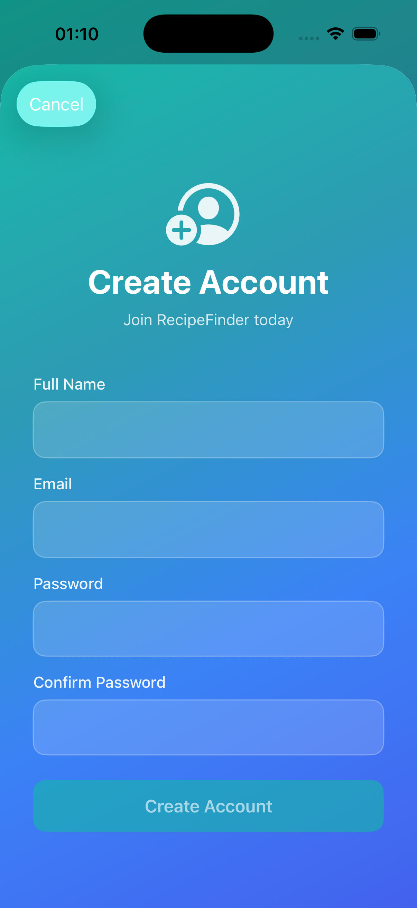
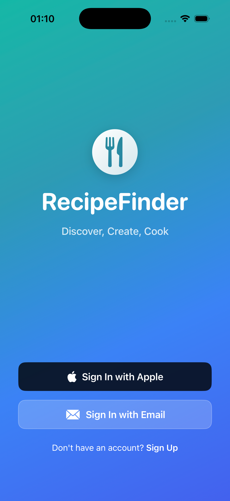
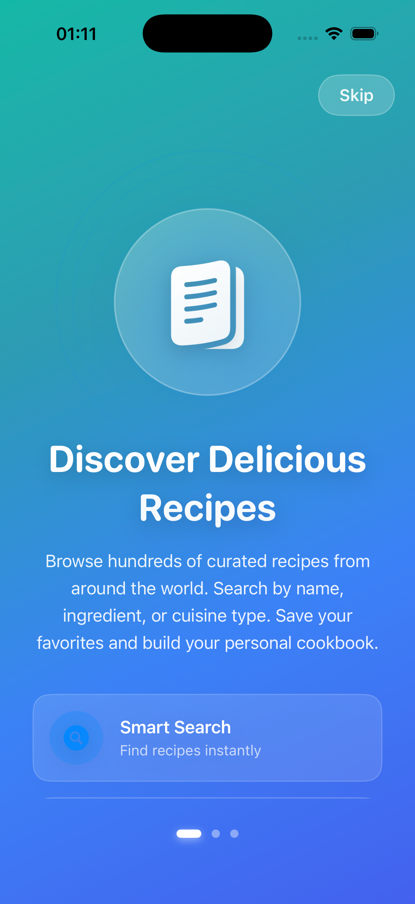

<div align="center">

# RecipeFinder™ 🍳

**Sophisticated recipe management with stunning design**  
*All your culinary treasures, beautifully organised. Completely private.*

[](https://github.com/RecipeFinderLimited/RecipeFinder/actions/workflows/build.yml)
[](https://www.apple.com/ios/)
[](https://swift.org/)
[](https://developer.apple.com/xcode/)
[](LICENSE)

**[Visit recipefinder.uk →](https://recipefinder.uk)**

</div>

## 📸 Demo

<div align="center">





*Beautiful recipe management from sign-up to cooking*

</div>

## ✨ Why RecipeFinder?

- **Privacy First** - Designed with your privacy in mind. See our Privacy Policy for details
- **Beautiful Design** - Six elegant color themes with seamless light/dark mode
- **Complete Toolkit** - Recipes, shopping lists, meal planning, kitchen inventory, and timers in one app
- **Smart Import** - Grab recipes from any website with automatic ingredient parsing
- **Offline Ready** - Full functionality without internet connection

## 🚀 Installation

### For Users
*Coming soon to the App Store*

### For Developers

```bash
git clone https://github.com/RecipeFinderLimited/RecipeFinder.git
cd RecipeFinder
open RecipeFinder.xcodeproj  # Press ⌘+R to run
```

**Requirements**: iOS 17.5+ • Xcode 16.0+ • Swift 6.0 • macOS 15.0+

## 📱 Features

### Core Features
- **📖 Recipe Management** - Curated collection, URL import, custom creation, favorites, and sharing
- **🛒 Smart Shopping Lists** - Auto-categorized ingredients, add from recipes, track inventory
- **🍽 Meal Planning** - Weekly calendar, schedule meals, add a week to your shopping list
- **🏠 Kitchen Inventory** - Track ingredients, expiry dates, find recipes you can make now
- **⏲ Cook Timer** - Step timer with background alerts and haptic feedback

### Security & Privacy
- **🔐 Local Authentication** - Face ID/Touch ID support with PBKDF2 password hashing (100,000 rounds)
- **🔒 Secure Storage** - iOS Keychain integration with Secure Enclave
- **🛡️ Privacy-Focused** - Designed with data protection and privacy in mind

### Design & Accessibility
- **🎨 Six Color Themes** - Beautiful palettes that work in light and dark modes
- **♿️ Accessible** - VoiceOver support, Dynamic Type, WCAG 2.1 AA contrast, 44pt tap targets
- **⚡️ Smooth Performance** - Hardware-accelerated rendering, optimized Core Data

## 🏗 Technical Stack

**Architecture**: SwiftUI with Clean Architecture (Presentation / Domain / Data) • Core Data persistence • Swift async/await concurrency  
**Dependencies**: [Kingfisher](https://github.com/onevcat/Kingfisher) (image loading & caching) • [ConfettiSwiftUI](https://github.com/simibac/ConfettiSwiftUI) (celebration effects)  
**Performance**: Hardware-accelerated rendering • Async image loading • Optimized Core Data fetches  
**Security**: Local-first storage • PBKDF2 password hashing (HMAC-SHA256, 100k rounds) • iOS Keychain • Secure Enclave biometrics  
**Privacy**: Privacy-focused design • See Privacy Policy for details  
**Accessibility**: VoiceOver support • Dynamic Type • WCAG 2.1 AA contrast • 44pt tap targets

## 🛠 For Developers

### Build Commands

```bash
# Pick any available iOS simulator (avoids hardcoding a device name)
SIMULATOR_ID=$(xcrun simctl list devices available --json \
  | jq -r 'first(.devices | to_entries[] | select(.key | test("iOS")) | .value[] | select(.isAvailable and (.name | test("iPhone"))) | .udid)')

# Run tests
xcodebuild test -scheme RecipeFinder \
  -destination "platform=iOS Simulator,id=$SIMULATOR_ID"

# Build for simulator
xcodebuild -scheme RecipeFinder \
  -destination "platform=iOS Simulator,id=$SIMULATOR_ID" \
  clean build

# Build for device
xcodebuild -scheme RecipeFinder \
  -destination 'generic/platform=iOS' \
  -configuration Release \
  clean build
```

### Project Structure

```
RecipeFinder/
├── Components/      # Reusable UI components
├── Views/          # Screen views
├── Models/         # Data models
├── Persistence/    # Core Data & managers
├── Theme/          # Design system
├── Utilities/      # Helpers & extensions
└── Services/       # Business logic
```

### Key Files
- `AppTheme.swift` - Complete design system
- `NotificationManager.swift` - Local notifications
- `PersistenceController.swift` - Core Data stack
- `RecipeImporter.swift` - Web recipe parsing

## 💬 Support & Contact

- 🐛 **Report Bugs**: [GitHub Issues](https://github.com/RecipeFinderLimited/RecipeFinder/issues)
- 💡 **Feature Requests**: [GitHub Discussions](https://github.com/RecipeFinderLimited/RecipeFinder/discussions)
- 📧 **Email**: recipefinderlimited@icloud.com
- 🌐 **Website**: [recipefinder.uk](https://recipefinder.uk)

> **Note**: This is proprietary software. Pull requests are not accepted.

## ⚖️ License & Legal

**Copyright © 2024-2026 RECIPEFINDER LIMITED. All Rights Reserved.**

This software is proprietary. Company No. 16833243 (England and Wales).

For complete terms, see:
- 📄 [Full License Agreement](./LICENSE)
- 🔒 [Privacy Policy](https://recipefinder.uk/privacy.html)
- 📋 [Terms of Service](https://recipefinder.uk/terms.html)

For licensing inquiries: recipefinderlimited@icloud.com

<div align="center">

---

**© 2024-2026 RECIPEFINDER LIMITED • All Rights Reserved**

Made with ❤️ in the UK • [recipefinder.uk](https://recipefinder.uk)

</div>
